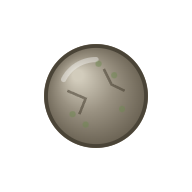

# 水滴合成深海 · 游戏说明

> 同种水滴相融合成 · 从一缕雾泡汇入深渊王座

**在线试玩**：<https://game.luosgeo.com> · **本地玩**：双击 `index.html` 即可，零依赖
支持触屏与鼠标：点击 / 拖动瞄准，松手投放。

---

## 🎮 基础玩法

- 点击屏幕任意位置投放顶部虚影所示的水滴；**同档水滴相碰即合成下一级**，得分并产生连击加成（连击窗口 1.1 秒，倍率最高 ×4）。
- **开局即无尽模式**：周期潮汐、珊瑚礁障碍、15 种特殊水滴随海域逐级解锁，并随对局时长渐进加压（约 14 分钟到满强度），越玩越狂。
- **警戒线判负**：水滴顶部越过上部虚线并**持续约 1 秒**即本局结束——竖直"叠罗汉"细柱同样判负（堆内微颤不影响计时，越线即开始累计）；堆体从下方逼近时警戒线闪烁，越线判定进行中线上会放大显示**合并提示「堆高越线 X.Xs」**（1Hz 同相呼吸、永不熄灭，危险越高越醒目；v333 起警戒线与该提示整体叠在水滴之上，不再被堆体遮挡）。每局首次越线有一次「死亡缓冲」宽限（引信延长、线上显示倒计时，不弹专用提示）；缓冲用尽后再次越线才结算。**冰冻滴与全部瞬态特殊滴**（漩涡 / 雨云 / 冰晶 / 磁吸 / 熔岩 / 间歇泉 / 虚空 / 极光 / 彩虹 / 雷霆 / 珍珠 / 甘霖）**不参与堆高判定**。结算页保留**复活继续**（直接回到对局，无广告；**复活时自动清走堆顶水滴**——普通水滴自堆顶向下移除，直到剩余堆顶退到警戒线下方安全区，被移除的水滴化作气泡消散，避免复活后立刻再次判负）/ 结算双倍 / 分享战报 / 重新开始。（v328：复活恢复、死亡缓冲改为倒计时、特殊滴豁免堆高；v329：倒计时 1Hz 缓闪、提示按语义分色 7 类（v331 定版）——金=得分 / 紫=生效高光 / 深青=海域推进 / 绿=奖励 / 琥珀=提醒 / 暗红=错失 / 蓝灰=操作回执；v330：复活清走堆顶水滴、缓冲倒计时无缝续接；v332：警示文字与倒计时统一 1Hz 同相呼吸，不再急促频闪；v333：合并为单条提示「堆高越线 X.Xs」、警戒线叠在水滴上层）
- 顶部任务条不断发布小目标（合成某档水滴 / 达成连击 / 合成出指定档位），难度随任务深度递进，完成即得奖励分并**随机充满一个技能**；右侧潮汐卡提示下次涨潮倒计时。
- 任务条下方的**海域进度条**实时显示累计得分距下一海域还差多少分（填充色与当前海域同族，右端圆点即下一海域徽章色），满级后显示「已达最深海域」。
- **高潮时刻**：每累计 +500 分，场上最高档的可合成对会自发相聚，省去机械投放。
- 局内底部一排六钮：**图鉴** + 四大技能 + **重开**；左上角**设置钮**可分别开关音效 / 音乐 / 震动，也可**清空存档**——二级确认后删除全部进度，游戏恢复初始状态。

### 合成链（9 级）

|  **雾泡** 1分 |  **水滴** 3分 |  **露珠** 6分 |  **浪花** 10分 |  **溪流** 15分 |  **湖泊** 21分 |  **江河** 29分 |  **大海** 38分 |  **沧海** 50分 |
| --- | --- | --- | --- | --- | --- | --- | --- | --- |

---

## ✨ 四大技能

合成带**符文**的水滴可为对应技能 +1 充能（普通投放约三成概率自带符文），攒满次数点亮即可点击释放；**对应符文首次出现即解锁该技能**——未解锁时按钮显示「待符文」，点击只会提示还差哪种符文。解锁状态跨局保留。

| 技能 | 充能 | 解锁 | 效果 |
| --- | --- | --- | --- |
|  换滴 | 4 次 | 「换滴符文」出现后 | 把当前待投水滴换成下一颗（救急调整阵容） |
|  涟漪 | 6 次 | 「涟漪符文」出现后 | 以水堆重心炸开双重波纹，把堆体推挤重排 |
|  蒸发 | 10 次 | 「蒸发符文」出现后 | 进入选择模式，点掉一枚碍事的水滴或珊瑚礁 |
|  水流 | 6 次 | 「水流符文」出现后 | 点选两枚水滴交换位置，精细调整合成组合 |

---

## 🎁 特殊水滴（15 种，随海域逐级解锁）

| 特殊滴 | 登场海域 | 效果 |
| --- | --- | --- |
|  符文滴 | 潮汐池 | 合成时为对应技能 +1 充能（技能随其首次出现解锁） |
|  雨云滴 | 珊瑚浅海 | 分裂成两颗雾泡，补充低级水滴 |
|  珊瑚礁 | 珊瑚浅海 | 沉重障碍无法合成；两两相消或蒸发移除 |
|  漩涡滴 | 蔚蓝深海 | 吸附周围水滴再消散，聚拢散滴 |
|  冰晶滴 | 蔚蓝深海 | 冻结周围水滴，冻结滴可当临时平台 |
|  彩虹滴 | 午夜深渊 | 碰到的水滴直接跳 2 级，得分双倍 |
|  疾风滴 | 午夜深渊 | 落定刮风吹开周围水滴，腾出空间 |
|  磁石滴 | 月光环礁 | 更强更久的磁场漩涡，大范围聚滴 |
|  甘霖滴 | 月光环礁 | 下一滴变成场上最多的档位 |
|  雷霆滴 | 海沟之眼 | 引雷让场上一对同档水滴直接合成 |
|  珍珠滴 | 海沟之眼 | 祝福最多的档位，该档全体升 1 级 |
|  熔岩滴 | 热泉裂谷 | 烧毁周围珊瑚礁与最低两档水滴，折算得分 |
|  间歇泉滴 | 热泉裂谷 | 向上喷出垂直水柱，冲开上方水滴腾出空间 |
|  虚空滴 | 深渊王座 | 吞噬场上最低档水滴（至多 5 颗），折算高分 |
|  极光滴 | 深渊王座 | 极光庇护：下一次合成得分 ×3 |

 对局中偶有**大宝箱**（潮汐池起出现）浮出，限时 14 秒点击开启可得随机奖励（只开出**已解锁的符文技能充能与已出现的特殊滴**，未解锁/未出现时改发积分；开启提示文字跟随宝箱同步移动）；涨潮间隙还有**随机深海事件**不期而至——**深海涌泉**（温和托起底部水滴）、**海神甘霖**（接下来 3 滴必为场上最多档位）、**漩涡风暴**（灵动漩涡卷起并在堆叠区重排水滴）。（v329：涌泉托起修复、漩涡视觉重绘、宝箱提示跟随、宝箱不开未解锁道具）

---

## 🌊 潮汐与海域演进

- **潮汐**：周期性涨潮，浮力把全场水滴托起重排。首潮倒计时与潮汐间隔相同：浅海 **42 秒**，随海域推进线性压缩至深海 **16 秒**；涨潮前 3 秒有预警。
- **潮水是清场压力**：满潮水位随海域推进**线性增高**——由「警戒线到容器底」高度的 **1/4（浅海，最贴近底部）逐步升至 3/4（深海「深渊王座」，最贴近警戒线但仍在线下约 112px）**，**全程始终低于警戒线**，潮汐只把水滴向上浮动重排、不再把任何水滴推过警戒线。把每次涨潮当作清场与整理阵容的期限。（v328：潮位改为 1/4~3/4 填充，杜绝越线）
- **潮汐限定合成**：两枚「江河」只能在涨潮时聚成「大海」（彩虹跳级不受限）——想合大海，卡准潮位。
- **海神恩泽**：退潮余波有概率引来祝福，全场普通水滴集体升 1 级——潮退后正是整理阵容、触发连环合成的窗口期。
- **海域演进**：按累计得分（跨局）从 8 大海域一路潜入，背景主题色随之平滑渐变：

|  **潮汐池** 0分 |  **珊瑚浅海** 3千 |  **蔚蓝深海** 1万 |  **午夜深渊** 2.5万 |  **月光环礁** 5万 |  **海沟之眼** 10万 |  **热泉裂谷** 18万 |  **深渊王座** 30万 |
| --- | --- | --- | --- | --- | --- | --- | --- |

---

## 📖 图鉴 · 成就殿堂 · 离线收益

- **图鉴**（局内左下书本钮）：合成链 9 档 + 海域演进 8 行，点选条目查看说明；海域行按「当前海域 / 已抵达 / 下一海域 · 累计X分 / ???」标注状态（以本局得分与生涯最高中抵达较深者为准，刷新重开不回退），未抵达的更深海域以 ??? 保持悬念。（v328：HUD 顶部「最远海域」统计现随本局实时刷新——当前潜得更深即时显示）
- **成就殿堂**（主页四枚磁贴直达，内含四个视图）：
  - **成就**：11 项成就分 ★ / ★★ / ★★★ 三档难度，完成得**永续加成**（如开局充能、连击窗口 +0.3s）与称号；
  - **每日任务**：每天 5 个，难度随连续完成天数递进（以星级标记），全部完成可涨连续天数；
  - **每日挑战**：每天轮换一条海况词缀、全服同规则；目标分 = 生涯最佳 × 35%，达成即完成，得奖励分与技能充能，连续完成天数越多奖励越高；挑战局内顶部会显示目标与进度；
  - **榜单**：好友深海榜，比比谁潜得更深。
- **离线收益**：离开超过 3 分钟即按离开时长结算积分（每分钟保底 30 分 + 生涯最佳系数，8 小时封顶），下次开局自动入账，主页弹出离线卡告知。

---

## 🏁 结算与词缀局（深渊潜航 / 每日挑战）

- 结算页四项：**复活继续**（直接回到对局，无广告；复活时自动清走堆顶水滴至安全区）/ **结算双倍**（直接翻倍）/ **分享战报**（自动生成战绩文案）/ **重新开始**（弹窗确认：返回主页 / 重新开始 / 返回游戏）。（v328：复活功能恢复——直接复活，去除广告；v330：复活清走堆顶水滴）
- **词缀局**：累计 5 万分解锁「**深渊潜航**」，或每天从主页磁贴进入「**每日挑战**」——都是带海况词缀的高危无尽局，词缀相同、每日挑战每天轮换开放其中一条：

| 词缀 | 海况 |
| --- | --- |
| 重压深潜 | 重力 +80% |
| 疾风骤雨 | 潮汐间隔 -65% |
| 暗礁密布 | 珊瑚礁概率 ×4 |
| 寒冰速冻 | 水滴 35% 落水即冻 |

每日挑战另有两条更凶的专属词缀：**深渊试炼**（重力 +40% 且潮汐 -65%）、**冰礁交错**（暗礁 ×5 且 45% 落水即冻）。

---

## 💡 小贴士

- 大水滴沉底、小水滴留两侧：**让同档水滴自然相邻**比强行堆叠更容易触发连锁合成。
- 连击（1.1 秒窗口）叠加得分倍率，最高 ×4——**连续快合成**是高分关键。
- 潮水会把堆体向上浮动重排：**把涨潮当清场与整理期限**，提前给高级滴腾合并空间。
- 漩涡 / 疾风 / 间歇泉都能救急腾空间；蒸发留着专拆珊瑚礁和卡位大滴。
- 珊瑚礁落在一起会**两两相消**，别急着蒸发它们。
- 「江河」留着涨潮时合「大海」，平时硬合合不上。

---

*水滴合成深海 · Merge Ocean — v334 · 更新于 2026-10-19*
*在线试玩 <https://game.luosgeo.com> · 纯静态零依赖，也可本地打开 index.html 游玩*
