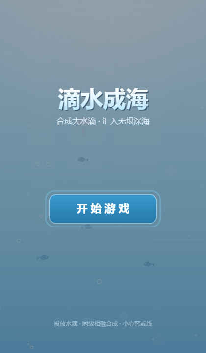
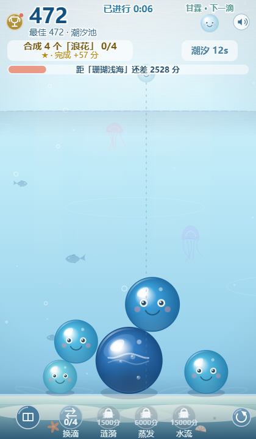
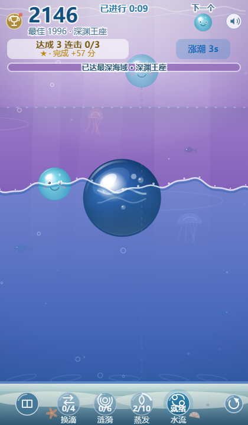
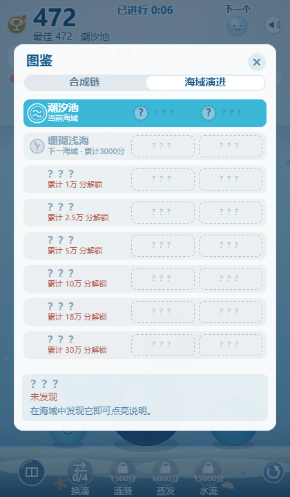
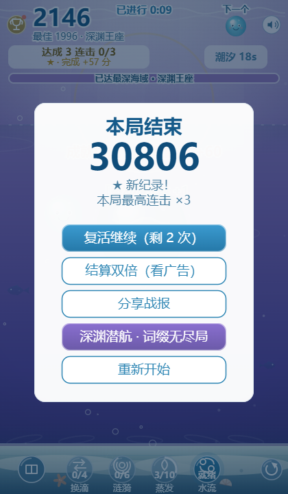

# 滴水成海 · 游戏说明

> 同种水滴相融合成 · 从一缕雾泡汇入深渊王座

**在线试玩**：<https://game.luosgeo.com> · **本地玩**：双击 `index.html` 即可，零依赖
支持触屏与鼠标：点击 / 拖动瞄准，松手投放。

| 开始界面 | 对局画面 |
| --- | --- |
|  |  |

---

## 🎮 基础玩法

- 点击屏幕任意位置投放顶部虚影所示的水滴；**同档水滴相碰即合成下一级**，得分并产生连击加成。
- **开局即无尽模式**：周期潮汐、礁石障碍、13 种特殊水滴随海域逐级解锁，且渐进加压越玩越狂。
- **警戒线判负**：水滴堆积越过上部虚线并保持静止约 1 秒即本局结束；每局可看广告复活 2 次。
- 顶部任务条不断发布小目标（如「合成 3 个水滴」），完成即得奖励分，高分任务还会直接充满技能；右侧潮汐胶囊提示下次涨潮倒计时。
- 任务条下方的**海域进度条**实时显示累计得分距下一海域还差多少分（填充色即下一海域主题色），满级后显示「已达最深海域」。

### 合成链（9 级）

| 档位 | 雾泡 | 水滴 | 露珠 | 浪花 | 溪流 | 湖泊 | 江河 | 大海 | 沧海 |
| --- | --- | --- | --- | --- | --- | --- | --- | --- | --- |
| 单次得分 | 1 | 3 | 6 | 10 | 15 | 21 | 29 | 38 | 50 |

---

## ✨ 四大技能

合成带**符文**的水滴可为对应技能 +1 充能，攒满次数点亮即可点击释放；技能按累计得分逐个解锁。

| 技能 | 充能 | 解锁 | 效果 |
| --- | --- | --- | --- |
| 🔄 换滴 | 4 次 | 开局即有 | 把当前待投水滴换成下一颗（救急调整阵容） |
| 🌊 涟漪 | 6 次 | 累计 1,500 分 | 以水堆重心炸开双重波纹，把堆体推挤重排 |
| 💨 蒸发 | 10 次 | 累计 6,000 分 | 进入选择模式，点掉一枚碍事的水滴或礁石 |
| 🔁 水流 | 6 次 | 累计 15,000 分 | 点选两枚水滴交换位置，精细调整合成组合 |

---

## 🎁 特殊水滴（13 种，随海域逐级解锁）

| 特殊滴 | 登场海域 | 效果 |
| --- | --- | --- |
| 漩涡滴 | 潮汐池 | 吸附周围水滴再消散，聚拢散滴 |
| 雨云滴 | 潮汐池 | 分裂成两颗雾泡，补充低级水滴 |
| 礁石 | 珊瑚浅海 | 沉重障碍无法合成；两两相消或蒸发移除 |
| 冰晶滴 | 蔚蓝深海 | 冻结周围水滴，冻结滴可当临时平台 |
| 符文滴 | 蔚蓝深海 | 合成时为对应技能 +1 充能 |
| 彩虹滴 | 午夜深渊 | 碰到的水滴直接跳 2 级，得分双倍 |
| 疾风滴 | 午夜深渊 | 落定刮风吹开周围水滴，腾出空间 |
| 磁石滴 | 月光环礁 | 更强更久的磁场漩涡，大范围聚滴 |
| 甘霖滴 | 月光环礁 | 下一滴变成场上最多的档位 |
| 雷霆滴 | 海沟之眼 | 引雷让场上一对同档水滴直接合成 |
| 珍珠滴 | 海沟之眼 | 祝福最多的档位，该档全体升 1 级 |
| 熔岩滴 | 热泉裂谷 | 烧毁周围礁石与最低两档水滴，折算得分 |
| 间歇泉滴 / 虚空滴 / 极光滴 | 深渊王座 | 水柱冲堆 / 吞噬低档折高分 / 下次合成得分 ×3 |

🎁 对局中偶有**深海宝箱**浮出，限时 14 秒点击开启可得随机奖励；涨潮间隙还有**随机深海事件**（漩涡风暴 / 涌泉）不期而至。

---

## 🌊 潮汐与海域演进

- **潮汐**：周期性涨潮（首潮前有 18 秒缓冲），浮力把全场水滴托起重排；潮水永不漫过警戒线，但会抬高堆体——潮退后是整理阵容的窗口期。涨潮前 3 秒有预警。
- **海域演进**：按累计得分（跨局）从 8 大海域一路潜入，背景主题色随之平滑渐变：

| 海域 | 潮汐池 | 珊瑚浅海 | 蔚蓝深海 | 午夜深渊 | 月光环礁 | 海沟之眼 | 热泉裂谷 | 深渊王座 |
| --- | --- | --- | --- | --- | --- | --- | --- | --- |
| 累计得分 | 0 | 3 千 | 1 万 | 2.5 万 | 5 万 | 10 万 | 18 万 | 30 万 |

---

## 📖 图鉴 · 成就 · 每日 · 榜单

- **图鉴**（左下书本钮）：合成链 9 档 + 海域演进 8 行，点选条目查看说明；未抵达的海域以 ??? 保持悬念。
- **成就**（左上奖杯钮）：12 项成就分三档难度，完成得**永续加成**（如开局充能、连击窗口 +0.3s）与称号；附每日三任务与好友榜单。

---

## 🏁 结算与「深渊潜航」二周目

- 结算页可**复活继续**、看广告**双倍结算**、**分享战报**（自动生成战绩文案）。
- 累计 5 万分解锁**深渊潜航**（紫色按钮）：选择一条海况词缀重开一局，难度更高、得分倍率更高：

| 词缀 | 海况 | 得分倍率 |
| --- | --- | --- |
| 重压之海 | 重力 +25% | ×1.5 |
| 疾风骤雨 | 潮汐间隔 -40% | ×1.6 |
| 暗礁密布 | 礁石概率 ×2 | ×1.5 |
| 冰封之海 | 15% 水滴落水即冻 | ×1.4 |

---

## 💡 小贴士

- 大水滴沉底、小水滴留两侧：**让同档水滴自然相邻**比强行堆叠更容易触发连锁合成。
- 连击（1.1 秒窗口）叠加得分倍率，最高 ×4——**连续快合成**是高分关键。
- 潮汐涨起时别慌，浮起的水滴正是**重排阵容、触发连环合成**的好机会。
- 漩涡 / 疾风 / 间歇泉都能救急腾空间；蒸发留着专拆礁石和卡位大滴。
- 礁石落在一起会**两两相消**，别急着蒸发它们。

---

*滴水成海 · Merge Ocean — v95 · 更新于 2026-10-16*
*在线试玩 <https://game.luosgeo.com> · 纯静态零依赖，也可本地打开 index.html 游玩*
